<!-- Profile README for github.com/BadhonRahman01 ───────────────────────────────────────────── • The banners live in ./assets (dark + light variants; GitHub picks one based on the visitor's theme). • Everything else is plain Markdown/HTML – edit freely. • Things marked TODO are the spots you will most likely want to touch. --> 
 <picture> <source media="(prefers-color-scheme: dark)" srcset="assets/header-dark.svg"> <source media="(prefers-color-scheme: light)" srcset="assets/header-light.svg">  </picture> 
 
      <!-- TODO: add Google Scholar when you have a profile:  --> 

About me

I'm a Doctoral Researcher at the Faculty of Information Technology, University of Jyväskylä (Finland), where I have been working on the security of quantum software since 2025 as part of the SeQuSoS project.

Before the PhD I completed an M.Sc. in Software Engineering at LUT University and worked as a Software Engineer, so I tend to look at quantum computing the way an engineer looks at any production system: as a stack of SDKs, compilers, cloud services and hardware that can be attacked, and should be defended.

The question behind my research is simple to state: how can a quantum software stack be breached, and what would it take to make it secure? I study it at two levels — the quantum software ecosystem itself, and the cloud pipelines (Quantum-as-a-Service) that take a circuit from a developer's laptop to real quantum hardware and back.

🎯 Interests: quantum computing · quantum software engineering · software security · threat modelling · security benchmarking

Research focus
<table> <tr> <td width="33%" valign="top"> <h3 align="center">🧨 What can go wrong</h3> 
Four families of attacks on the quantum software stack — <b>crosstalk</b>, <b>side-channel</b>, <b>fault injection</b> and <b>pulse-level</b> — broken down into 14 attack classes, each with its origin, its consequences and known specimens.
 
<i>Journal of Systems and Software, 2026</i>
 </td> <td width="33%" valign="top"> <h3 align="center">☁️ Where it happens</h3> 
An end-to-end <b>STRIDE threat model</b> of the six-stage <b>Quantum-as-a-Service pipeline</b>: developer environment, authentication &amp; submission, cloud compilation, shared hardware, result return and the hybrid loop — including everything that sits outside the user's trust boundary.
 
<i>IEEE Quantum Week 2026, poster</i>
 </td> <td width="33%" valign="top"> <h3 align="center">📏 How to measure and fix it</h3> 
<b>Security Figures of Merit</b> (S-FoMs) mapped to ISO/IEC 25010 and to the pipeline stages, plus a benchmarking rubric that normalises them and rolls them up into one <b>Quantum Software Security Posture (QSSP)</b> score — so that, for the first time, security tools and techniques can be compared on a common scale. On the defence side: 30+ mitigations mapped to the attack families.
 
<i>IEEE Quantum Week 2026, workshop paper</i>
 </td> </tr> </table> 
 <code>4</code> attack families &nbsp;·&nbsp; <code>14</code> attack classes &nbsp;·&nbsp; <code>30+</code> mitigations &nbsp;·&nbsp; <code>6</code> pipeline stages &nbsp;·&nbsp; <code>13</code> S-FoMs &nbsp;·&nbsp; <code>1</code> QSSP score 
 
 <picture> <source media="(prefers-color-scheme: dark)" srcset="assets/pipeline-dark.svg"> <source media="(prefers-color-scheme: light)" srcset="assets/pipeline-light.svg">  </picture> 

Publications
<!-- Newest first. Each entry has a collapsible BibTeX block. -->

Classification of security challenges and mitigation approaches in the quantum software engineering  B. Rahman, M. Haghparast, T. Mikkonen — Journal of Systems and Software, vol. 238, 112884 (2026) · peer-reviewed · JUFO 3 · open access (CC BY 4.0)    

 
BibTeX

bibtex
@article{rahman2026classification,
  title   = {Classification of security challenges and mitigation approaches in the quantum software engineering},
  author  = {Rahman, Badhon and Haghparast, Majid and Mikkonen, Tommi},
  journal = {Journal of Systems and Software},
  volume  = {238},
  pages   = {112884},
  year    = {2026},
  doi     = {10.1016/j.jss.2026.112884}
}

On the Figures of Merit for Quantum Software Security: Toward a Benchmarking Rubric  B. Rahman, M. Haghparast, T. Mikkonen — accepted at IEEE International Conference on Quantum Computing and Engineering (QCE26 / IEEE Quantum Week), workshop paper · JUFO 1   

 
BibTeX

bibtex
@misc{rahman2026figures,
  title         = {On the Figures of Merit for Quantum Software Security: Toward a Benchmarking Rubric},
  author        = {Rahman, Badhon and Haghparast, Majid and Mikkonen, Tommi},
  year          = {2026},
  eprint        = {2608.05831},
  archivePrefix = {arXiv},
  note          = {Accepted at IEEE International Conference on Quantum Computing and Engineering (QCE), workshop paper}
}

An End-to-End Threat Model for the Quantum-as-a-Service Pipeline  B. Rahman, M. Haghparast, T. Mikkonen — accepted at IEEE International Conference on Quantum Computing and Engineering (QCE26 / IEEE Quantum Week), poster paper   

 
BibTeX

bibtex
@misc{rahman2026threatmodel,
  title         = {An End-to-End Threat Model for the Quantum-as-a-Service Pipeline},
  author        = {Rahman, Badhon and Haghparast, Majid and Mikkonen, Tommi},
  year          = {2026},
  eprint        = {2608.05836},
  archivePrefix = {arXiv},
  note          = {Accepted at IEEE International Conference on Quantum Computing and Engineering (QCE), poster paper}
}

 
Full list on <a href="https://orcid.org/0009-0004-4431-6442">ORCID</a>.

Toolbox
<!-- TODO: adjust to what you actually use day to day. --> 
 <b>Quantum&nbsp;&nbsp;&nbsp;&nbsp;&nbsp;&nbsp;</b>    
 
 <b>Engineering</b>        
 
 <b>Research&nbsp;&nbsp;&nbsp;&nbsp;&nbsp;</b>     

The path so far

 <picture> <source media="(prefers-color-scheme: dark)" srcset="assets/timeline-dark.svg"> <source media="(prefers-color-scheme: light)" srcset="assets/timeline-light.svg">  </picture> 

On GitHub

 <picture> <source media="(prefers-color-scheme: dark)" srcset="https://github-readme-stats.vercel.app/api?username=BadhonRahman01&show_icons=true&bg_color=0d1117&border_color=30363d&title_color=22d3ee&text_color=c9d1d9&icon_color=a78bfa"> <source media="(prefers-color-scheme: light)" srcset="https://github-readme-stats.vercel.app/api?username=BadhonRahman01&show_icons=true&bg_color=ffffff&border_color=d0d7de&title_color=0e7490&text_color=1f2328&icon_color=6d28d9">  </picture> <picture> <source media="(prefers-color-scheme: dark)" srcset="https://streak-stats.demolab.com/?user=BadhonRahman01&background=0D1117&border=30363D&stroke=30363D&ring=22D3EE&fire=A78BFA&currStreakNum=E6EDF3&sideNums=E6EDF3&currStreakLabel=22D3EE&sideLabels=8B949E&dates=8B949E"> <source media="(prefers-color-scheme: light)" srcset="https://streak-stats.demolab.com/?user=BadhonRahman01&background=FFFFFF&border=D0D7DE&stroke=D0D7DE&ring=0E7490&fire=6D28D9&currStreakNum=1F2328&sideNums=1F2328&currStreakLabel=0E7490&sideLabels=656D76&dates=656D76">  </picture> 
 
 <picture> <source media="(prefers-color-scheme: dark)" srcset="https://github-readme-stats.vercel.app/api/top-langs/?username=BadhonRahman01&layout=compact&langs_count=8&hide=c%23,powershell,mathematica,ruby,objective-c,objective-c%2B%2B,cuda&bg_color=0d1117&border_color=30363d&title_color=22d3ee&text_color=c9d1d9"> <source media="(prefers-color-scheme: light)" srcset="https://github-readme-stats.vercel.app/api/top-langs/?username=BadhonRahman01&layout=compact&langs_count=8&hide=c%23,powershell,mathematica,ruby,objective-c,objective-c%2B%2B,cuda&bg_color=ffffff&border_color=d0d7de&title_color=0e7490&text_color=1f2328">  </picture> 
 
Most of my public repositories date from my software-engineering years (Laravel, Vue, PHP). The quantum-security work currently lives mostly in the papers above.

Let's talk

I'm always glad to hear from people working on quantum software security, threat modelling for Quantum-as-a-Service, security benchmarking, or quantum software engineering in general — whether it's about a paper, a tool, or just a question.

📧 badhon.b.rahman@jyu.fi  ·  🎓 University profile  ·  🆔 ORCID  ·  💼 LinkedIn

  
<code>|ψ⟩ = α|engineer⟩ + β|researcher⟩</code>

